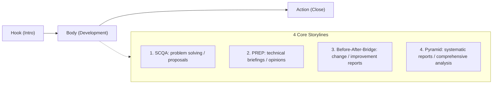

# Slide Quality Guidelines: Content, Structure, and Readability Principles

These guidelines are practical directions for AI and slide authors to create high-quality
presentation slides that "communicate, move, and read easily."
Beyond visual beauty, they maximize **"what is being said (content)," "how the argument flows
(structure)," and "whether it is understood at a glance (readability)."**

---

## 1. Content Quality Criteria: "So What?" and Specificity

### 1.1 Enforce Message-Driven Titles
Slide titles must not be bare nouns or topic names ("About…", "Overview", "Diagram").
Declare **"the single most important conclusion or implication of the slide (So What?)"** in the title or lead.

| ❌ Topic titles to avoid (bare nouns) | ✅ Recommended message-driven titles (conclusion/implication) |
|---|---|
| `## System Architecture` | `## Microservices Cut Deploy Time by 60%` |
| `## Development Progress` | `## API Work On Schedule; UI Integration Finished a Week Early` |
| `## Cloud Comparison` | `## Adopting Cloudflare over AWS for Cost and Learning Curve` |
| `## Issues and Countermeasures` | `## Mandating Automated Tests and CI Pipelines to End Hero-Driven Ops` |
| `## Summary` | `## Platform Renewal Done This Term; Next Term Focuses on Fast Feature Delivery` |

> **Rule**: The slide's point should be 80% clear from the title alone.
> When a topic name is needed, combine it with a category badge or small subtitle.
> Example: `<span class="badge blue">System Architecture</span>` + `## Go Adoption Cuts API Response from 80ms to 15ms`

---

### 1.2 Eliminate Abstractions, Back with Facts & Figures
Abstractions like "improved," "enhanced," "managed properly," or "flexible response" carry no
specifics and persuade nobody. Always pair **"by what means"** with **"what numbers or facts."**

- ❌ Abstract: *"We greatly strengthened security"*
- ✅ Concrete: *"OAuth 2.0 and mTLS on all endpoints now block 100% of unauthorized access attempts"*
- ❌ Abstract: *"We will improve development efficiency"*
- ✅ Concrete: *"A shared component library cuts screen implementation effort by 30% on average"*

---

### 1.3 Audience-First Value (WIIFM Principle)
**WIIFM (What's In It For Me?)**:
Don't just list what the presenter wants to say (product specs, war stories) — lead with benefits
and impact for the audience.

1. **Decision makers (managers, executives)**: cost, risk, ROI, schedule impact
2. **Fellow engineers**: selection rationale, architecture trade-offs, reusability, operability
3. **Business / sales**: customer experience gains, competitive edge, release timing

---

## 2. Structure Quality Criteria: Persuasive Storylines

Presentation success is decided not by individual slides but by "how the logic connects."
Pick the best storyline from the four frameworks below according to purpose and theme.



### 2.1 The Four Storyline Templates

#### 1. SCQA (problem solving, proposals, project launches)
Share the context, raise the problem, and lead inevitably to the solution — the business classic.
1. **Situation**: objective facts and background everyone agrees on
2. **Complication**: changes, bottlenecks, obstacles encountered
3. **Question**: "So how do we solve this?"
4. **Answer**: the concrete solution from this proposal (product, method)
5. **Impact / Action**: expected outcomes, resources, next steps

#### 2. PREP (tech selection, architecture proposals, opinions)
Put the conclusion first and last to communicate most logically and clearly in little time.
1. **Point**: what should be done, what is claimed
2. **Reason**: why — qualitative and logical grounds
3. **Example**: benchmarks, prototype results, concrete cases
4. **Point**: restated conclusion with outlook

#### 3. Before-After-Bridge (process improvement, new tooling, refactoring)
Emphasize the gap of change to make the proposal's value stand out.
1. **Before**: current pain — inefficiency, high cost, stress
2. **After**: the ideal future — comfort and overwhelming gains after improvement
3. **Bridge**: the concrete means and steps to get from Before to After

#### 4. Pyramid (status reports, exhaustive reviews, overall strategy)
Top with the key message, supported by three MECE (mutually exclusive, collectively exhaustive) pillars.
1. **Top Message**: overall project status or summary message
2. **Key Pillar 1**: schedule/milestone progress with evidence
3. **Key Pillar 2**: quality/test results and risk countermeasures
4. **Key Pillar 3**: cost/resource status
5. **Decisions / Next Actions**: items needing approval, upcoming actions

---

### 2.2 Transitions Between Slides (Wayfinding)
- **Setup and payoff**: end each slide on the "question" that the next slide "answers."
- **Show where you are (Wayfinding)**:
  - For decks of 10+ slides, insert a section divider or agenda recap (`toc-focus`) at major section breaks so the audience never gets lost.

---

## 3. Readability & Cognitive Load Criteria: Practicing the 3-Second Rule

Slides are not "read" — they are "seen."
Design the information structure so **the key message lands within 3 seconds of appearing.**

### 3.1 Escape Bullets (Anti-Bullet-Point) Rules
The easiest trap for AI is plain sentence bullets (Bullet Point Hell). Structure instead of listing:

#### Pattern A: [Key Label + Concise Explanation] (mandatory format)
Even when using bullets, always lead with a bold key phrase (label).

```markdown
<!-- ❌ Bad: just chopped-up long sentences -->
- The new cloud platform we started adopting last fiscal year is costing more to operate than expected
- Alert notification settings were insufficient, so fault detection took a long time
- We plan to introduce automation tooling to reduce manual effort going forward

<!-- ✅ Good: key label + concise explanation reads instantly -->
- **Surging ops cost**: +35% vs. plan (mainly over-provisioned resources from cloud migration)
- **Slow fault detection**: poor alert thresholds delayed initial response by 45 minutes
- **Driving ops automation**: Terraform + Ansible to cut 40 hours of monthly ops work
```

#### Pattern B: Convert to Cards / 2-Column Contrast (`cols-2`, `cols-3`, `split-2`)
Turn 2–3 parallel key points into card layouts (`cols-2` / `cols-3`), not bullets.

#### Pattern C: Turn Processes into Steps (`steps` / `timeline`)
Use the `steps` or `timeline` classes — not bullets — for sequences, procedures, and timelines.

---

### 3.2 Eye Guidance (Z-Pattern / F-Pattern) and Anchors
Human eyes flow **"top-left → top-right → bottom-left → bottom-right."**

```
[1. Claim title / lead (conclusion / So What?)]  ← 80% understood here
┌─────────────────────────┬─────────────────────────┐
│ [2. Main visual]        │ [3. Details]            │
│ - Big Number            │ - Evidence, background  │
│ - Comparison cards /    │ - Next actions          │
│   diagrams              │                         │
└─────────────────────────┴─────────────────────────┘
```

1. **Top / top-left (anchor)**: the most important message (claim title)
2. **Center / left**: the most visual element (diagram, big number, hero comparison card)
3. **Right / bottom**: supporting explanation, evidence, details

---

### 3.3 Readability Thresholds

Enforce the following numbers when creating or generating slides.

| Item | Recommended / Max | Reason |
|---|---|---|
| **Main message per slide** | **Strictly one** (1 Slide = 1 Message) | Mixed messages dilute impact |
| **Bullet count** | **Max 3–4** (Magic Number 3) | 5+ items are not remembered (split or cardify) |
| **Chars per line** | **Within 25–40 chars** | Beyond 40 chars, eye travel causes fatigue |
| **Indent depth** | **Max 2 levels** | 3+ levels signal broken structure |
| **Total chars per slide** | **Around 200–350 chars** | Beyond 400 chars it is a document, not a slide |

---

## 4. Quality Self-Check Sheet

Before producing or outputting slides, confirm every answer is "YES."

- [ ] **Title**: Is it a conclusion/claim rather than an "About…" topic?
- [ ] **Specificity**: Are abstractions like "improve" backed by numbers or concrete means?
- [ ] **Story**: Does the previous slide's problem connect logically to this slide's solution?
- [ ] **Bullets**: Are they key-labeled or card-structured instead of plain sentence lists?
- [ ] **Density**: 3–4 items max with enough whitespace?
- [ ] **3-second check**: Does the most important point jump out at a glance?
