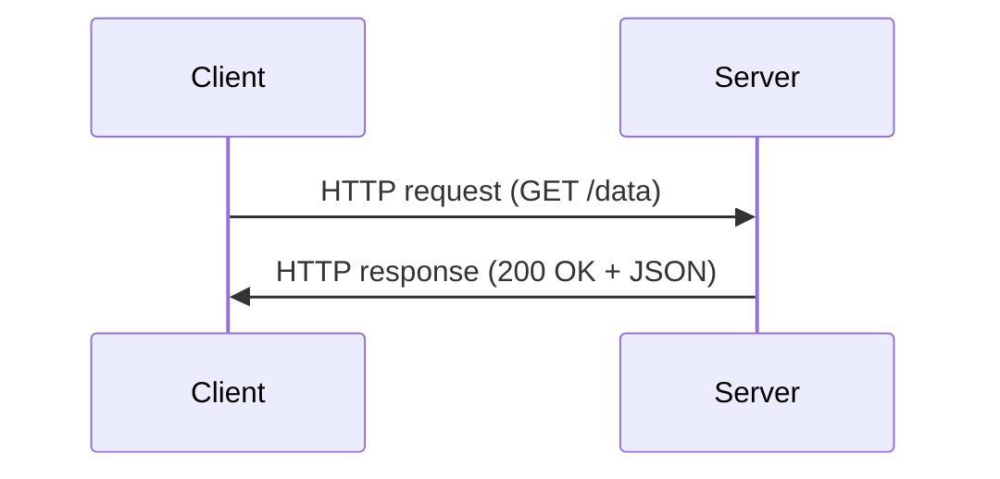

# Marp Slide Creator

A comprehensive guide for creating high-quality Marp presentations using AI.

## 1. Marp Fundamentals & Directives

For Marp configuration, file organization, global and local directives, please **read `references/marp-syntax-guide.md`**.

## 2. Slide Structure & Directives

For local slide directives (`_class`, `_paginate`, etc.), **read `references/marp-syntax-guide.md`**.

### ⚠️ List Alignment in Centered-Layout Classes

Several classes apply `text-align: center` to the entire slide section, which causes bullet lists to render centered instead of left-aligned:

**Affected classes:** `cover`, `cover-wave`, `cover-diagonal`, `cover-noir`, `cover-aurora`, `cover-nebula`, `hero`, `title-only`, `title-elegant`, `key-message`, `align-center`
(`cover-wave/diagonal/noir/aurora/hero/title-only/title-elegant` are Prism Edge-only; `cover-nebula` is Nebula Glass-only. On other themes those names do nothing — check the theme's CSS first.)

**Rule:** Do not place bullet lists (`-` or `*`) or numbered lists on slides that use these classes. Lists belong on content slides with the default (left-aligned) layout.

If you must include a list on a centered-layout slide, override alignment with scoped CSS:

```markdown
<style scoped>
section ul, section ol { text-align: left; }
</style>
```

### Presenter Notes

```markdown
# Slide Content

Visible content here.

<!--
Presenter notes (only in presenter view)
-->
```

## 3. Image Syntax

For syntax on inline images, background images, and image filters, **read `references/marp-syntax-guide.md`**.

> **Export-safe rule**
> HTML scrollability is not a valid fallback for PDF/PPTX deliverables. If a code block, Mermaid diagram, table, or callout needs scrolling or clipping to stay readable, split it or redesign it.

## 4. Preview & Feedback Loop

> **⚠️ MANDATORY: Preview confirmation is required, not optional.**
> Slide creation is NOT complete until every slide has been visually verified.

### Workflow (MUST follow this order)

```
 0. Edit Markdown
    (edit-tool rule: ALWAYS end newString with a newline, and never place
      content on the same line as `---`)
 1. Run post-edit-check.py (structural sanity + language contamination)
 2. Run marp-lint.py (catches structural errors BEFORE rendering)
 3. Resolve ALL lint warnings HERE — do not proceed with warnings pending
 4. Run marp-diagnostics.py (DOM metrics only; see note below)
 5. If DOM issues -> fix -> repeat from step 1
 6. Generate images ONCE with marp-cli --images png (single source of truth)
 7. Read every slide image EXACTLY ONCE in a single batch (see Stage 4)
 8. If visual issues -> fix -> repeat from step 1
 9. Cleanup temp files → Complete
```

**Why these rules exist (2026-09 regression post-mortem):**
- A missing trailing newline glued a paragraph to its `---`, silently merging
  two slides and breaking a `grid-quadrant` — `marp-lint.py` alone did NOT
  catch it. Only step 1 catches this class of bug.
- Two parallel image pipelines (`marp-diagnostics --screenshot-dir` vs
  `marp-cli --images png`) produced different/stale outputs, causing repeated
  re-reads of the same images and a large token waste. **Never use two image
  sources for one deck.**
- Proceeding to image review with pending lint warnings (DENSE_CONTENT etc.)
  forced the edit→render cycle to restart multiple times.

### Stage 0: Post-Edit Sanity Check (MANDATORY, run on every edit)

```powershell
python skills/marp-slide-creator/scripts/post-edit-check.py slides/my-deck/my-deck.md --expect <N>
# after rendering, also cross-check the HTML:
python skills/marp-slide-creator/scripts/post-edit-check.py slides/my-deck/my-deck.md --expect <N> --html slides/my-deck/preview.html
```

Detects what `marp-lint.py` cannot:
- `SLIDE_SEPARATOR_GLUED`: `---` glued to text (silently merges slides)
- `SLIDE_COUNT_MISMATCH`: slide count != `--expect` (use the approved outline count)
- `MISSING_EOF_NEWLINE`: the root cause of glued separators
- `LANGUAGE_CONTAMINATION`: simplified-Chinese-only characters in JP/EN content
- `HTML_SECTION_MISMATCH`: rendered `<section>` count != Markdown slide count

> **Markdown table borders `|---|` are recognized as valid and NOT flagged.**
> Exit code 0 = pass. Do not continue while exit code is 1.

### Stage 1: Pre-Render Lint (MANDATORY SECOND STEP)

**Always run the pre-render linter BEFORE marp-diagnostics.py.** It catches structural issues that the DOM extractor CANNOT detect (because the CSS never activates when the structure is wrong).

```powershell
python skills/marp-slide-creator/scripts/marp-lint.py slides/my-deck/my-deck.md
```

It detects:
- `MISSING_CLASS_DIRECTIVE`: `<div class="columns">` without matching `<!-- _class: cols-2 -->` (layout won't activate)
- `CENTERED_LIST`: Bullet lists on centered-layout slides (renders centered, not left-aligned)
- `OVERSIZED_ICON`: Catalog SVG icons used larger than 200px (icons are for small decorative use only)

> **⚠️ DO NOT skip this step.** The DOM extractor reports "no issues" even when layouts are completely broken because the content simply stacks vertically inside the slide's overflow:hidden container.

### Stage 2: Unified Diagnostics (DOM metrics only)

After lint passes clean, run the unified diagnostic helper to export HTML and run DOM analysis:

```powershell
python skills/marp-slide-creator/scripts/marp-diagnostics.py --theme themes/prism-edge.css slides/my-deck/my-deck.md
```

> `--theme` takes a path to a theme CSS file. The themes ship in
> `ai-centric-marp-themes/themes/`; copy the one you use into your deck repo
> (e.g. `<deck>/themes/`) and point `--theme` at that copy, so the command works
> from any working directory.

This helper exports `slides/my-deck/preview.html` and writes DOM analysis to `slides/my-deck/assets/dom-metrics.json`.

> **⚠️ Do NOT pass `--screenshot-dir` here.** `marp-diagnostics` screenshots and
> `marp-cli --images png` outputs must never be mixed: two image pipelines
> produced diverging/stale files in practice, which led to repeated re-reads of
> the same slides. **Image generation happens in Stage 4 only.**

### Stage 3: DOM Metrics Extraction

If you already have a rendered HTML file and only want to run the extractor without rebuilding, you can run the extractor directly:

**Step 1: Run DOM Extractor**
```powershell
python skills/marp-slide-creator/scripts/marp-dom-extractor.py slides/my-deck/preview.html -o slides/my-deck/assets/dom-metrics.json
```
> Screenshots are intentionally NOT generated here — image generation happens
> in Stage 4 only (single image pipeline).

**Step 2: Analyze JSON**

Auto-detected risk flags:
- `CONTENT_OVERFLOW`: Content past slide bottom
- `DENSE_TEXT`: >600 characters
- `MANY_LINES`: >20 lines
- `IMAGE_NO_SRC`: Missing image source
- `IMAGE_BROKEN`: Failed to load

Manual checks from `elements` array:
- Element overlap
- Text truncation (`clipped: true`)
- Unbalanced layout
- Missing expected images

### Stage 3.1: Reliable Image Verification

**Never** report images as "OK" based solely on file existence or size if you cannot visually confirm them.

- **If you have Vision capabilities**: Use Stage 4 (Image-based Feedback Loop) to see the actual rendered slides.
- **If you DO NOT have Vision capabilities** (or the user opted-out):
    - Report: "Image verification skipped (Vision unavailable/opt-out)".
    - You may still report "File exists" if `marp-diagnostics.py` shows no `IMAGE_MISSING` flags, but do NOT call it "OK" or "Verified".
- **Binary Read Errors**: If `view_file` fails with a binary error when trying to view a PNG/JPG, do NOT assume the file is valid. This error simply means the file is binary.
- **`view_file` usage**: When viewing binary images, do NOT provide `StartLine` or `EndLine` arguments.

### Stage 4: AI Visual Inspection (Image-based Feedback Loop)

When you (the AI) need to visually confirm the actual layout, contrast, and element positioning, you can generate and analyze screenshots directly. This is the most reliable way to check complex layouts.

**⚠️ PERMISSION CHECK:** Before performing this stage, ensure the user has explicitly opted-in to "Visual layout checks" or "AI Vision". If not, do NOT proceed with image generation and stick to Stage 3 DOM Metrics.

**Step 1: Generate Images — SINGLE SOURCE OF TRUTH (marp-cli only)**

```powershell
# Delete any previous images FIRST (stale images caused misidentification before)
Remove-Item -Path "slides/my-deck/assets/screenshots" -Recurse -Force -ErrorAction SilentlyContinue

# Pinned to package.json / tool_versions.py; override via MARP_CLI_SPEC.
npx -y @marp-team/marp-cli@4.2.3 --no-stdin --allow-local-files `
  --theme themes/<theme>.css slides/my-deck/my-deck.md `
  --images png -o slides/my-deck/assets/screenshots/slide
```

Then normalize names to `slide-001.png` style (see note below) and **verify the
file count equals the slide count from `post-edit-check.py` BEFORE reading
any image.**

> **Rules (post-mortem, 2026-09):**
> - **Never use two image pipelines for one deck** (e.g. `marp-diagnostics
>   --screenshot-dir` AND `marp-cli --images png`). Diverging/stale outputs
>   caused repeated re-reads and large token waste.
> - **Never read an image twice.** If an image seems inconsistent with its
>   filename, that is a *hypothesis*, not a fact: check the file hash/count
>   via shell first. Only regenerate after a confirmed mismatch — do not
>   re-read the same file hoping it will change.
> - If `marp-cli -o` emits extension-less `slide.001` files, rename them to
>   `slide-001.png` with a single `ForEach-Object` loop before reading.

**Step 2: Slide Identification Protocol (MANDATORY — run for EVERY image)**
To avoid misidentifying slide numbers during visual inspection:
1. **Render with Pagination**: If not already present, ensure `paginate: true` is set in the frontmatter.
2. **Three-point match**: filename number ↔ rendered page number in the footer ↔ expected title from the outline. All three must agree before judging the slide.
3. **Verify Content**: Confirm the slide title/key text matches the Markdown slide you intend to edit.
4. **Source of Truth**: The rendered page number in the image is the source of truth for *which* slide is being seen.
5. **One pass**: Read all images ONCE in a single batch, record every issue with its slide number, then fix everything in one edit round. Do not stream image→fix→image; interleaving caused re-reads and lost track of which version was rendered.

**Step 3: Inspect the Images (Visual Quality Checklist)**
Use your file viewing tool (`view_file`) on the specific generated image(s) you need to check. This will load the image into your context. Inspect the slide against the following visual quality criteria:
- **Contrast**: Is there sufficient color contrast between the text and background/background-image? (Particularly check pale text on light backgrounds or keycards).
- **Overlap**: Are text elements, SVG icons, background shapes, or Mermaid diagrams overlapping or blocking each other?
- **Alignment & Balance**: For column/grid layouts (e.g., `cols-2`, `cols-3`, `grid-quadrant`), is the height and layout of content balanced? Are the margins symmetrical?
- **Typography**: Are Japanese/English fonts rendering correctly without ugly fallback fonts (like default Mincho or broken character rendering)?

**Step 4: Cleanup (MANDATORY)**

Once you have reviewed the images and made necessary corrections to the Markdown, you **MUST** delete the temporary images and render artifacts to keep the workspace clean.
```powershell
Remove-Item -Path "slides/my-deck/assets/screenshots" -Recurse -Force
Remove-Item -Path "slides/my-deck/preview.html", "slides/my-deck/assets/dom-metrics.json" -Force -ErrorAction SilentlyContinue
```

## 5. Readability & Content Structure (Anti-Bullet-Point Principle)

Presentation slides are visual communication tools, not long-form documents. Apply the **3-Second Rule**: an audience member should grasp the core takeaway within 3 seconds of looking at the slide.

### 5.1 Ban the "Bullet Point Hell" (Unstructured Text Walls)
Never dump 5–7 lines of raw bullet text. Instead, format content into structured, scannable units:

- **Bold Key Labeling (MANDATORY for lists)**:
  Always prefix bullet items with a concise bold keyword or short phrase:
  ```markdown
  <!-- ❌ BAD: Raw sentence fragments -->
  - We experienced significant latency spikes during morning peak hours
  - Database connection pool was completely exhausted
  - Cache hit ratio dropped below 40% due to cache stampede

  <!-- ✅ GOOD: Bold Key Labels + concise explanations -->
  - **Latency Spikes**: p99 response time degraded to 4.2s during morning peak
  - **Connection Exhaustion**: DB pool capped at 100 conns, starving API workers
  - **Cache Stampede**: Uncached keys caused 85% DB read fallback
  ```

### 5.2 Convert Lists into Visual Structures
Whenever a slide has 2–4 parallel concepts, do not default to standard bullets:
- **Parallel Concepts / Comparisons**: Use `<div class="columns">` with `<!-- _class: cols-2 -->` or `cols-3` (cards) or `split-2`.
- **Sequential Workflows**: Use `<!-- _class: steps -->` with numbered list `1. **Step**: Details`.
- **Timelines / Chronology**: Use `<!-- _class: timeline -->`.
- **2x2 Trade-offs / Quadrants**: Use `<!-- _class: grid-quadrant -->`.

### 5.3 Cognitive Density & Limits
- **Magic Number 3**: Stick to 3 (max 4) key concepts per slide.
- **Line Length**: Keep bullet explanations under 40 characters per line.
- **Slide Word Count**: Target 200–350 characters total per slide. Over 400 characters is a document, not a presentation slide—move details to presenter notes (`<!-- notes -->`) or split the slide.

### 5.4 "So What?" Heading Rule
Headings must declare the conclusion, not just the topic.
- ❌ `## Microservices Transition`
- ✅ `## Microservices decouple teams, cutting release lead time by 60%`

## 6. Content Overflow Solutions

Priority order (most design-friendly first):

### 6.1 Content Refinement
- Bulletize paragraphs
- Remove redundancy
- Stick to "1 slide = 1 message"
- Use active voice
- Move lists off centered-layout slides (`cover`, `cover-nebula`, `hero`, `title-only`, `title-elegant`, `key-message`, etc.) — lists on those slides render centered, not left-aligned

### 6.2 Per-Slide Font Size
```markdown
<style scoped>
section { font-size: 20px; }
section li { font-size: 18px; }
</style>
```

### 6.3 Global Font Size
```markdown
---
style: |
  section { font-size: 22px; }
---
```

### 6.4 CSS Utility Classes
```markdown
<div class="text-small">
Content here
</div>
```

### 6.5 Split Slides
```markdown
# Topic (1/2)
- First half

---

# Topic (2/2)
- Second half
```

### 6.6 Image Resize
```markdown


```

### 6.7 Table Overflow
```markdown
<style scoped>
section table { font-size: 16px; }
</style>
```

### 6.8 Export-Safe Code and Diagrams
- Avoid `overflow-x: auto`, clipped panes, or hidden scrollbars for content that must survive PDF/PPTX export.
- Keep code examples short enough to fit on the slide; if not, split them across slides or move the full version to notes or an appendix.
- Simplify Mermaid diagrams before shrinking them. If the diagram would need scrolling, switch to multiple slides or use `.drawio.svg`.
- Prefer readable excerpts over tiny text that only works in browser preview.

## 7. Quality Checklist

### 🚨 Critical Structure (MUST verify — these cause silent failures):
- [ ] **Every `<div class="columns">` slide has `<!-- _class: cols-2 -->` (or cols-3/split-2/split-3/split-asym/split-asym-reverse) in its directive** — without this, the layout does NOT activate and content stacks vertically
- [ ] **Every `<div class="grid">` slide has `<!-- _class: grid-quadrant -->` or `<!-- _class: grid-sharp -->` in its directive** — same reason
- [ ] **Every `<div class="profile-layout">` slide has `<!-- _class: profile -->`**
- [ ] **No bullet/numbered lists on centered-layout slides** (`cover`, `key-message`, `align-center`, plus theme-specific `cover-wave/diagonal/noir/aurora/hero/title-only/title-elegant` on Prism Edge and `cover-nebula` on Nebula Glass) — lists render centered, not left-aligned
- [ ] **No catalog SVG icons used larger than width:200px** — icons are for inline/decorative use only (≤48px for cards, ≤36px for headings)
- [ ] `post-edit-check.py` passes (exit 0): no glued `---`, slide count matches `--expect`, no language contamination
- [ ] `marp-lint.py` reports zero issues **(zero warnings too — resolve them before image review)**

### 📖 Content, Message & Readability:
- [ ] **Headings state conclusions/takeaways** (not just generic nouns like "Overview", "Architecture", or "Next Steps")
- [ ] **Lists use bold key labels** (`- **[Key Label]**: explanation`) rather than unstructured walls of text
- [ ] **Magic Number 3 applied**: max 3–4 key points/cards per slide
- [ ] **Concrete metrics and evidence used** instead of vague claims ("faster", "improved")
- [ ] **No slide exceeds ~350 characters** of total body text (split or move excess to presenter notes)

### Structure (verify before preview):
- [ ] Column layouts use `<div class="col">` or `<div>` for each column
- [ ] Grid layouts have exactly 4 `<div class="cell">` children
- [ ] Inline classes (`badge`, `gradient-text`) use `<span>`, not `<div>`
- [ ] Alignment classes (`v-center`/`text-center`) may be used at slide level or on column divs

### Layout:
- [ ] No text overflow/cutoff
- [ ] No scroll-dependent code, Mermaid, or table regions in PDF/PPTX decks
- [ ] Images don't overlap text
- [ ] Consistent margins

### Typography:
- [ ] Clear heading hierarchy
- [ ] Readable font size (≥16px)
- [ ] Purposeful emphasis

### Visual:
- [ ] Consistent color scheme
- [ ] Good text/background contrast
- [ ] Aligned tables
- [ ] Diagrams/icons where appropriate
- [ ] **Images verified visually** (or explicitly reported as "unverified" if vision unavailable)

### Content:
- [ ] One idea per slide
- [ ] Concise bullet points
- [ ] Images serve a purpose

## 8. Visual Aids & Icons

### SVG Icons

After drafting, review for empty space. Add icons from `marp-svg-icon-placer` skill catalog.

**Always activate `marp-svg-icon-placer` skill before selecting icons.**

### Diagram Choice

Use the simplest visual that communicates the idea clearly:

1. Start with SVG icons for small accents, status markers, and lightweight labels.
2. Use Mermaid when the slide needs a sequence, flow, state, or relationship diagram that can be expressed cleanly in code.
3. Use `.drawio.svg` when Mermaid is too limited, when precise layout matters, or when the diagram needs richer shape control.
4. If drawio still cannot represent it cleanly, or the quality is not good enough, ask the user to provide a source image.

### Integrating `marp-diagram-creator` Skill

When a task requires creating or embedding a diagram, **activate the `marp-diagram-creator` skill**. It handles engine selection (Mermaid vs draw.io), theme-aware rendering, and canvas validation.

**When to activate:**
- User asks to "add a diagram", "visualize the flow/architecture", "draw a sequence/flowchart"
- A slide needs a diagram that goes beyond a simple SVG icon
- Any `.mmd` or `.drawio` file needs to be rendered into a slide-ready SVG

**Integration workflow with this skill:**

```
1. Activate marp-diagram-creator skill. It owns the diagram engine, which ships
   inside that skill under `vendor/`. Resolve it once:
     ENGINE=$(python <marp-diagram-creator-skill-dir>/scripts/print-engine-path.py)
2. Identify: target theme + slide layout (full / col2 / asym / col3)
3. Generate diagram SVG:
     python "$ENGINE/render-slide-diagram.py" \
       -i "$ENGINE/templates/mermaid/<template>.mmd" \
       -o slides/<deck>/assets/diagrams/<name>.svg \
       --theme <theme-name> --layout <layout>
4. Validate output (auto-runs inside render-slide-diagram.py, or manually):
     python "$ENGINE/validate-slide-diagram.py" \
       slides/<deck>/assets/diagrams/<name>.svg --layout <layout>
5. Embed SVG in Marp slide:
     
6. Run marp-lint.py — the DIAGRAM_MISSING_WIDTH / DIAGRAM_OVERFLOW_WIDTH
   checks will catch embedding mistakes before rendering.
```

> Inside a clone of `ai-centric-marp-themes` the engine is also at
> `scripts/diagrams/` (the development source). Prefer `marp-diagram-creator`'s
> vendored copy so this workflow keeps working when only the skills are installed.

**Safe diagram widths by layout (canonical: `layout_spec.py::EMBED_WIDTH` / `CANVAS_MAX`):**

| Layout | `_class` directive | Recommended `width:` | Hard max |
|---|---|---|---|
| Full slide | (default) | `width:1050px` | 1120px |
| 2-column | `cols-2`, `split-2`, `split-glass`, `glass-card-layout` | `width:500px` | 520px |
| Asymmetric | `split-asym`, `split-asym-reverse` (wide side) | `width:680px` | 710px |
| 3-column | `cols-3`, `split-3` | `width:320px` | 340px |

**Output path convention:** Always save generated diagram SVGs to:
```
slides/<deck-name>/assets/diagrams/<diagram-name>.svg
```

### Mermaid Diagrams

**⚠️ IMPORTANT: Do NOT use inline Mermaid code blocks in Marp slides.**

Mermaid diagrams often fail to render correctly in Marp preview and export. Instead, use Mermaid CLI to convert diagrams to SVG offline, then insert the SVG as an image.

**Workflow:**

1. Create a `.mmd` file in `slides/project-name/assets/diagrams/`:



2. Convert to SVG using Mermaid CLI:

```powershell
# Pinned to package.json / tool_versions.py; override via MERMAID_CLI_SPEC.
npx -y @mermaid-js/mermaid-cli@12.0.0 -i slides/project-name/assets/diagrams/sequence.mmd -o slides/project-name/assets/diagrams/sequence.svg
```

3. Insert the SVG in your slide:

```markdown

```

**Good Mermaid use cases:**
- Sequence diagrams
- Flowcharts
- Simple state transitions
- Dependency or relationship diagrams

**Prefer `.drawio.svg` instead when:**
- The diagram needs precise positioning or many cross-links
- The slide must match a specific visual style
- The diagram is too dense to read comfortably in Mermaid
- You need more control over styling and layout

### Editable Diagrams

Use `.drawio.svg` format for complex diagrams (architecture, workflows).

## 8. Contrast-Aware Design

**Core Rule:** Emphasized elements and their containers must have different background colors.

### Universal Checklist

1. What is the most important element on this slide?
2. Does it have a background color?
3. What is directly behind it?
4. Are the colors similar? If yes, emphasis is lost.
5. Fix: Change layout, move element, or change color.

### Anti-Patterns

- **DO NOT** place `callout.info` inside `cols-2`/`cols-3` (same pale background)
- **DO NOT** place pale callouts on matching-tone background images
- **DO NOT** assume documented classes are visually compatible

## 9. Export & Delivery

For export commands and Quick Reference patterns (Cover Slide, Columns, Split layout), **read `references/marp-syntax-guide.md`**.
