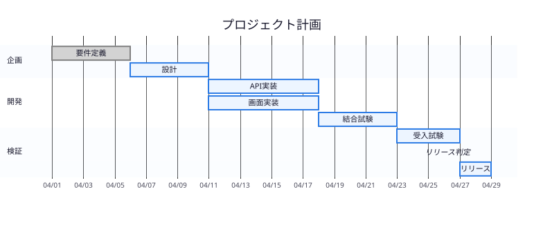
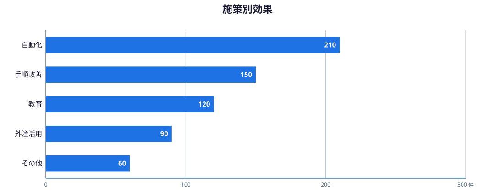
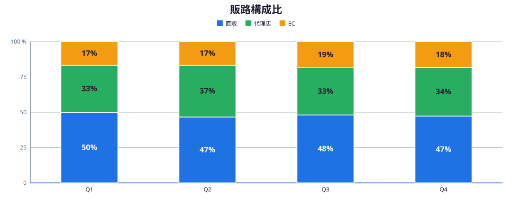
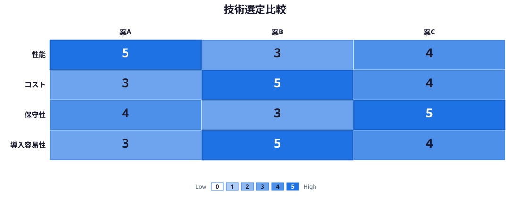

<!-- _class: cover subtitle meta -->
<!-- _paginate: false -->
<!-- _header: "" -->
<!-- _footer: "" -->

# 新図版ショーケース
## Gantt・ER・C4・ mindmap・水平バー・100%積上げ・比較マトリクス
ai-centric-marp-themes | 2026年9月

---

# 開発計画はGanttで一望化する

`mermaid/gantt-milestone.mmd` — 3セクション・7タスク+マイルストン、full限定

---

# データ関係はERで3实体に絞る

`mermaid/er-simple.mmd` — direction LRで3実体を横配置、full限定

---

# システム境界はC4コンテキストで示す

`mermaid/c4-context-compact.mmd` — 利用者+システム+外部3件、full/asym

---

# 発散整理はmindmapで俯瞰する

`mermaid/mindmap-compact.mmd` — root+3枝・深さ2迄、full/asym

---

# 長いラベルは水平バーで読みやすくする

`charts/task-hbar.json` — type `hbar`、全レイアウト対応

---

# 構成比の変化は100%積上げで比較する

`charts/channel-100-bar.json` — type `stacked-bar-100`、全レイアウト対応

---

# 選定判断はスコアマトリクスで可視化する

`concepts/tech-selection-matrix.json` — type `matrix` (0-5点)、全レイアウト対応
